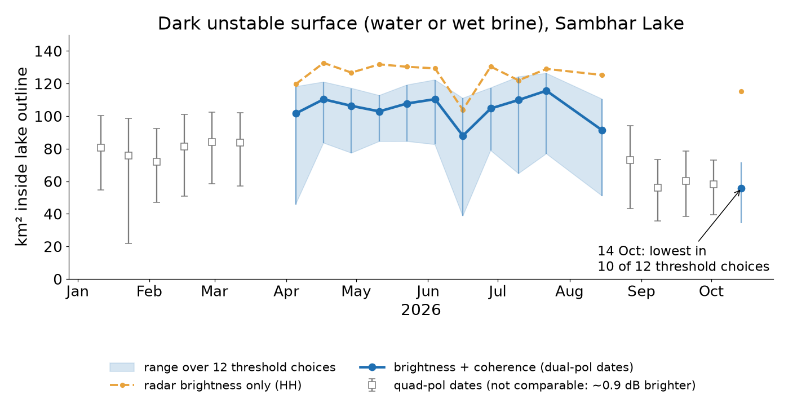
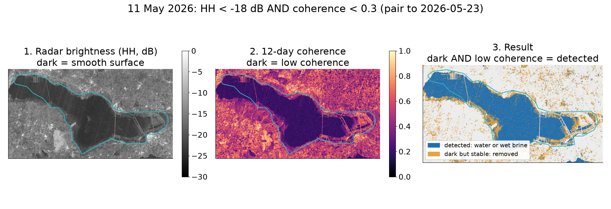
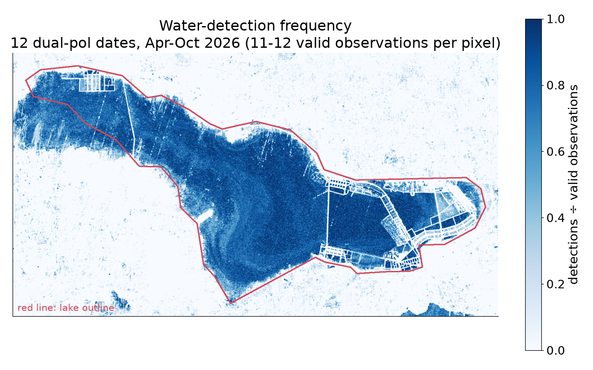

# Sambhar Watch

**Tracking surface water at Sambhar Salt Lake through a full year with NASA–ISRO NISAR radar.**

Built for the NASA Space Apps Challenge 2026, challenge *Dancing with the SARs*.

## The question

Sambhar Salt Lake, about 70 km west of Jaipur, is India's largest inland saline lake and a Ramsar wetland. Industrial salt pans operate inside and around it. A 2026 study by NRSC-ISRO and VIT-AP found that natural water area fell from 131 km² (2022) to 117 km² (2023) while salt-pan area grew from 49.5 to 51.5 km². The authors note the need to distinguish industrial salt pans from natural wetland area.

The lake changes most during the monsoon, when clouds often block optical satellites. NISAR's L-band radar sees through cloud. We ask:

> **How does detected surface water change through the year, inside and outside mapped salt pans, and how reliably can radar tell that water apart from wet salt crust?**

## Data

| Source | What | Use |
|---|---|---|
| NISAR GCOV (NASA/ASF) | L-band HH and HV backscatter, descending track 34, frame 75, 24 dates (Nov 2025 – Nov 2026) | Main measurements |
| NISAR GUNW (NASA/ASF) | 12-day interferometric coherence, same track and frame, 19 pairs | Telling water apart from smooth salt crust |
| Sentinel-2 (ESA) | Cloud-free optical images | Independent validation |
| Hand-drawn polygons | Salt-pan boundaries, `data/pans.geojson`; lake outline, `data/lake.geojson` | Inside/outside comparison; areas within the lake only |

`data/granules.csv` lists every NISAR file used. Two radar modes alternate (`DHDH` dual-pol, `QPDH` quad-pol); both contain HH and HV. One date (7 Nov 2026) comes from the later validated release and is analysed separately. On stable ground QPDH HH is about 0.9 dB brighter than DHDH (`scripts/check_modes.py`), so the main series uses DHDH dates only (Apr–Oct 2026) and QPDH dates are shown separately.

GCOV values are gamma-zero backscatter in linear power, terrain-corrected (RTC), on a 10 m UTM grid (EPSG:32643). Pixels flagged invalid by the file's own `mask` layer are treated as "no observation". **Thermal noise correction is not applied in these products**, so the darkest pixels (calm water, very smooth crust) may be close to the radar's noise floor, where their brightness no longer tells them apart.

`data/gunw_pairs.csv` lists the 12-day GUNW pairs for the same track (found by searching NASA CMR for `NISAR_L2_GUNW_PROVISIONAL_V1` over Sambhar). Three longer gaps (60, 24 and 24 days) are left out.

## Method

1. **Crop**: stream only the Sambhar area from each NISAR file and resample every date onto one fixed 20 m grid (`scripts/crop_lake.py`).
2. **Classify**: convert to decibels, lightly reduce speckle, and keep pixels that are both **dark** (HH below a threshold) and **unstable** (12-day coherence below a threshold). Calm water reflects the radar pulse away from the satellite, so it appears dark; but smooth salt crust and dry fields can be dark too. Water changes between passes, so its coherence is low, while crust and fields stay coherent. Until Sentinel-2 confirms it, the class is called *dark unstable surface (water or wet brine)*. Thresholds and the evidence for them are in `sambhar/config.py`. Each date uses exactly one 12-day pair, so every date is treated the same way: the pair starting on it, or, if there is none, the pair ending on it (`pair_direction` = forward/backward in the results; `pair_modes` shows when the two dates used different radar modes). Every area also comes with a min-max range over 12 threshold combinations (`scripts/sensitivity.py`), because the thresholds change the areas more than the season does.
3. **Measure**: area per date inside the hand-drawn lake outline (152 km²), split into *salt works and mapped pans* (49.1 km² of the lake; the largest shape covers the whole eastern salt-works section, reservoirs included) and *outside mapped pans* (103.0 km²). Pan shapes outside the lake are rough and are not used. Also the **water-detection frequency** of each pixel (detections ÷ valid observations) (`scripts/map_water.py`). The HH-only result is kept alongside to show how much dark but stable surface coherence removes.
4. **Validate**: compare against labelled Sentinel-2 points, reporting water vs salt crust separately. *(in progress)*

## Repository layout

```
sambhar/            reusable code
  config.py         all settings (study area, grid size, threshold)
  granules.py       list of NISAR files and remote access
  nisar.py          reading GCOV HDF5 files
  coherence.py      reading 12-day coherence from GUNW HDF5 files
  grid.py           common map grid and resampling
  water.py          dB conversion, speckle filter, water classification, frequency
  pans.py           salt-pan polygons to pixel mask
  plots.py          figures
  storage.py        saving/loading cropped dates
scripts/            the steps you run
  crop_lake.py      step 1
  map_water.py      step 2
  check_coherence.py  water vs salt crust: brightness and coherence of test regions
  sensitivity.py    how much the areas change with the chosen thresholds
  check_modes.py    do the two radar modes (DHDH, QPDH) agree on stable ground?
  make_figures.py   figures for the README and slides (docs/figures/)
tests/              synthetic end-to-end test (lake of known area)
data/               granule and interferogram-pair lists, salt-pan polygons
outputs/            generated files (not committed)
```

## Run it

Needs Python 3.10 or newer (macOS's built-in Python 3.9 is too old).

```bash
python3.12 -m venv .venv && source .venv/bin/activate
pip install -r requirements.txt
python tests/test_pipeline.py                        # check everything works offline
python scripts/crop_lake.py 2026-05-11 --show-structure
python scripts/crop_lake.py all
python scripts/check_coherence.py 2026-05-11 2026-08-15   # dry season and monsoon pairs
python scripts/check_coherence.py all                     # coherence for every 12-day pair
python scripts/map_water.py --suggest-threshold      # look, then choose a threshold
python scripts/map_water.py --mode DHDH              # HH + coherence rule, and HH-only for comparison
python scripts/sensitivity.py --mode DHDH            # areas for a range of thresholds
python scripts/check_modes.py                        # DHDH vs QPDH brightness on stable ground
```

A free [NASA Earthdata](https://urs.earthdata.nasa.gov) account is needed to stream NISAR data.

## Results

All areas are inside the hand-drawn lake outline (152 km²). "Detected" means *dark unstable surface (water or wet brine)* was seen on that date; it does not mean water was present all the time in between, and depth is not measured.



*15 August vs 14 October:* with the same thresholds on both dates, 14 October is lower in all 12 threshold choices, by about 17–39 km². Both dates use mixed-mode coherence pairs (15 Aug: DHDH→QPDH; 14 Oct: QPDH→DHDH), so they are treated alike; our mode check found coherence consistent between modes; separate QPDH dates in September–early October (56–60 km²) agree with the October value.

**Main series: 12 dual-pol (DHDH) dates, April–October 2026.** In brackets: the range over 12 threshold choices (HH −17 to −20 dB, coherence 0.25 to 0.35).

| Date | Detected, km² (range) | Salt works and mapped pans | Outside mapped pans | HH only, km² | Removed by coherence | Coherence pair modes |
|---|---|---|---|---|---|---|
| 2026-04-05 | 101.6 (46–118) | 26.4 | 75.3 | 119.6 | 18.0 | DHDH-DHDH |
| 2026-04-17 | 110.3 (84–121) | 27.1 | 83.2 | 132.7 | 22.4 | DHDH-DHDH |
| 2026-04-29 | 106.3 (77–117) | 25.0 | 81.3 | 126.7 | 20.4 | DHDH-DHDH |
| 2026-05-11 | 102.9 (84–113) | 22.9 | 80.1 | 131.8 | 28.9 | DHDH-DHDH |
| 2026-05-23 | 107.8 (84–119) | 26.7 | 81.1 | 130.3 | 22.5 | DHDH-DHDH |
| 2026-06-04 | 110.4 (83–122) | 28.4 | 82.0 | 129.3 | 18.9 | DHDH-DHDH |
| 2026-06-16 | 88.0 (39–111) | 26.1 | 61.8 | 103.9 | 16.0 | DHDH-DHDH |
| 2026-06-28 | 104.7 (79–117) | 27.7 | 77.0 | 130.4 | 25.7 | DHDH-DHDH |
| 2026-07-10 | 109.9 (65–124) | 26.2 | 83.7 | 122.0 | 12.1 | DHDH-DHDH |
| 2026-07-22 | 115.6 (77–126) | 28.7 | 86.9 | 129.0 | 13.4 | DHDH-DHDH (pair ending on date) |
| 2026-08-15 | 91.3 (51–110) | 22.5 | 68.8 | 125.3 | 33.9 | DHDH-QPDH |
| 2026-10-14 | 55.7 (34–72) | 15.8 | 39.9 | 115.4 | 59.6 | QPDH-DHDH (pair ending on date) |

What we found:

1. **Coherence removes 12–60 km² per date** that brightness alone would call water: surfaces that are dark but did not change over 12 days, such as smooth dry crust. On 11 May, HH alone flags about 132 km² of the lake; with coherence, about 103 km².
   
2. **April to August shows no clear seasonal pattern.** Detected area stays between about 88 and 116 km², and which date is largest depends on the thresholds. On a single date the thresholds move the area by about 40 km² (median), more than the differences between these dates (`scripts/sensitivity.py`).
3. **14 October is clearly lower** (about 56 km², range 34–72 over threshold choices): it is the lowest date in 10 of the 12 threshold choices, 30–40 km² below the next date at −17/−18 dB. The quad-pol dates of September and early October are also low (56–60 km²). **Sentinel-2 on 13 October** (1 day before the radar date, by eye inside the lake): about 55–60% white crust (about 85–90 km²) across the western arm, central basin and southern margins; about 20–25% open water (about 30–40 km²); about 15–20% pans, mudflats and shore. The same white pattern is there on 10 October, so this is persistent crust, not a short-lived film. Crust spread from a thin band at the edge on 29 August to most of the basin by 13 October. Radar with coherence on 14 October (about 56 km²) is above the optical water estimate, likely because of the shallow reservoir and wet edges; brightness alone (about 115 km²) would count most of the crust as water.
4. **The two radar modes cannot be mixed.** On stable ground, quad-pol (QPDH) HH is about 0.9 dB brighter than dual-pol (DHDH): all three mode changes point the same way (−0.43, +0.89, −1.39 dB) while dates in the same mode differ by 0.1–0.7 dB. Coherence agrees across modes (farmland 0.47–0.51 vs 0.39–0.55). So only April–October is one series; January–March and late August–early October (QPDH) are shown separately as grey points (`scripts/check_modes.py`).
5. **Sentinel-2, compared by eye** (not the validation below):
   - January: about 85–90% of the lake is water. Radar with coherence (QPDH, 11 and 23 Jan) detects only 50–53%. The validation below shows the misses come from the coherence step, not from brightness: HH alone finds 89% of the January water points.
   - May: water under a short-lived white film. Radar on 11 May: 68% of the lake.
   - August: about 55–60% water plus a band of about 30% crust. Radar on 15 Aug: 60%, so the crust band is mostly not counted as water.



**Water-detection frequency** (detections ÷ valid observations, 11–12 valid observations per pixel): the central and eastern lake bed is detected on most dates; the edges less often. About 14.5 km² just outside the south-west of the lake outline is detected on at least half the dates; it is not counted in the areas above.

### Validation against labelled Sentinel-2 points

The team labelled 203 points by eye on three cloud-free Sentinel-2 images (197 inside the lake) as water, salt crust, land, or white/uncertain (white in the optical image, can't tell). Each was compared with the nearest NISAR date (`scripts/validate.py`). Accuracy counts water against crust + land; white/uncertain points are reported on their own. An MNDWI audit flagged 5 of 203 blind labels as mixed-edge or white-film pixels; all labels were kept unchanged to avoid post-hoc bias.

**Inside the lake, all three dates:**

| | Brightness + coherence | Brightness only (HH) |
|---|---|---|
| Water points detected (recall) | 60% (80/134) | 89% (119/134) |
| Detections that are water (precision) | 89% (80/90) | 79% (119/150) |
| Salt crust called water | **24%** (9/37) | **81%** (30/37) |
| Land called water | 17% (1/6) | 17% (1/6) |
| White/uncertain called water | 85% (17/20) | 95% (19/20) |
| Non-water (crust + land) correctly rejected | 76.7% (33/43) | 27.9% (12/43) |
| **Balanced accuracy** (water and non-water weighted equally) | **68.2%** | **58.4%** |
| Plain accuracy | 63.8% (113/177) | 74.0% (131/177) |

76% of validation points were water (134 of 177), so plain accuracy rewards over-counting: a model that always says "water" scores 75.7% (balanced accuracy 50%). Weighting water and non-water equally, coherence is better (68% vs 58%), while brightness still finds more water.

**Per date, inside the lake** (plain accuracy; water recall; crust called water; too few non-water points per date for balanced accuracy):

| Sentinel-2 date → NISAR date (mode) | Brightness + coherence | Brightness only |
|---|---|---|
| 11 Jan → 11 Jan (QPDH) | 44% (25/57); 42%; 0/2 | 86% (49/57); 89%; 2/2 |
| 11 May → 11 May (DHDH) | 74% (34/46); 77%; 3/8 | 78% (36/46); 91%; 6/8 |
| 29 Aug → 27 Aug (QPDH) | 73% (54/74); 68%; 6/27 | 62% (46/74); 86%; 22/27 |

**How to read this: the two methods bracket the true water area.**
- **Brightness only is an upper bound.** It finds nearly all water (89%) but also calls most salt crust water (81%).
- **Brightness + coherence is a lower bound.** When it says water it is right 89% of the time and it rejects most crust (only 24% called water), but it misses 40% of water points, mostly in January (it finds 42% of January water against 89% for brightness alone). Why some January water stays coherent over 12 days is unresolved. Possible reasons, none tested: calm, stable shallow water or thin brine films; stable features smaller than a pixel (salt rafts, mud ridges); coherence estimates biased upward where the signal is weak.
- **Which method to trust depends on the state of the lake.** With a full lake and little crust (January), brightness alone is more accurate (86% vs 44%). When crust is spreading (late August), brightness + coherence is better (73% vs 62%). In May the two are similar (74% vs 78%). In the area chart above, the dashed and solid lines can be read as these upper and lower bounds.
- On 11 May, 19 points looked white in the optical image but showed water on Sentinel-2 images 5 days before and after; radar with coherence called 17 of them water.

**Limits of this check:** the samples are small (inside the lake: 37 crust points, only 2 of them in January; 20 white/uncertain; 6 land), there are only three dates, and two of them (11 Jan, 27 Aug) are QPDH dates outside the main DHDH series; only 11 May is in it. The 29 Aug optical image is 2 days from the 27 Aug radar date. Labels were made by eye. Accuracy on these dates does not prove accuracy all year.

Figures are made with `python scripts/make_figures.py` after `map_water.py --mode DHDH` and `sensitivity.py --mode QPDH`.

## Limitations

- NISAR products used are provisional (calibrated, partially validated); one date is from a later release.
- Thermal noise correction is not applied in these products, so the darkest pixels may sit near the noise floor.
- Wet salt crust can look as dark as water in radar. This is the main source of error and is tested explicitly.
- Observations are 12 days apart (with some gaps): results mean "water detected on these dates", not continuous presence. Depth is not measured.
- The pan / non-pan split comes from our hand-drawn polygons. "Outside mapped pans" may still contain unmapped pans, channels or roads.
- Mapped changes are surface observations only and say nothing about legality.
- Each date is resampled to 20 m by nearest neighbour (no multilooking), and the 3×3 speckle smoothing is done in dB, not in linear power.
- GUNW coherence is estimated over a coarser window than the 10 m GCOV pixels, so thin features (shorelines, embankments) are blurred in coherence.
- The hand-drawn lake outline leaves out part of the south-west lake bed (about 14.5 km² detected on at least half the dates lies just outside it).

One strength: all dates come from the same track and frame (descending track 34, frame 75), so the viewing geometry and incidence angle are the same throughout the year.

## Use of AI

AI assistants (Claude) were used to research the topic, check data availability, draft code and review our reasoning. All results were run, checked and interpreted by the team.

## License

MIT. Data: NASA/ASF (NISAR), ESA Copernicus (Sentinel-2), under their respective terms.
